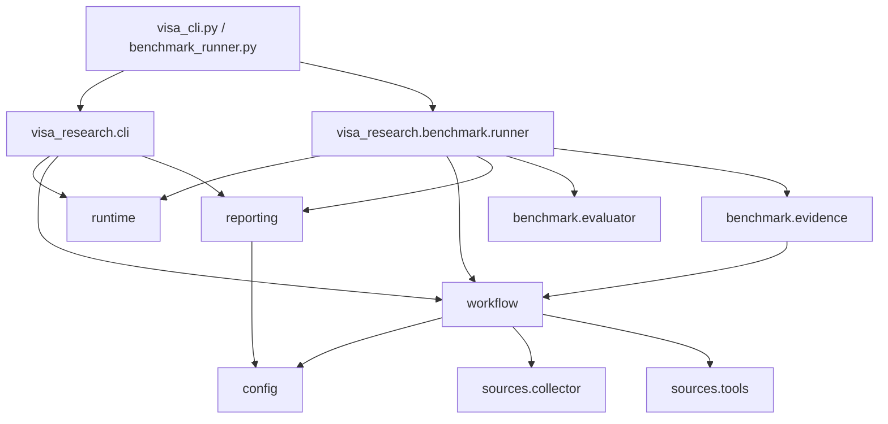
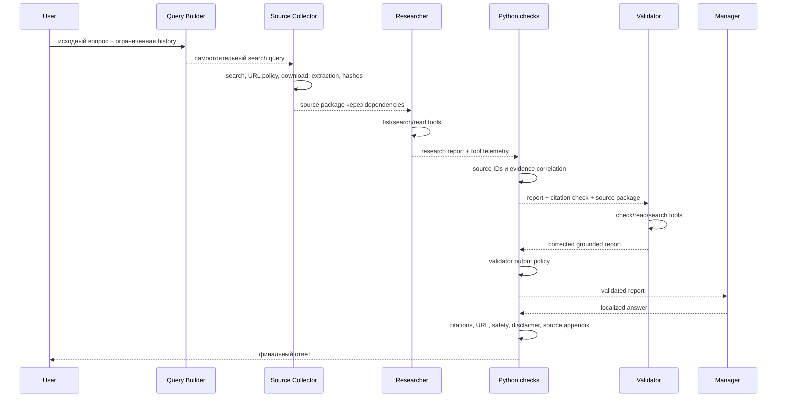
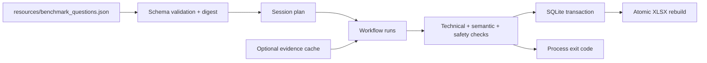

# Архитектура Visa Research Workflow

## 1. Карта репозитория

```text
.
├── README.md
├── visa_cli.py
├── benchmark_runner.py
├── doc/
│   ├── README.md
│   ├── OVERVIEW.md
│   ├── DESIGN.md
│   └── ARCHITECTURE.md
├── resources/
│   ├── benchmark_questions.json
│   ├── requirements.txt
│   └── requirements.lock
├── scripts/
│   ├── run_cli.sh
│   ├── run_benchmark.sh
│   └── run_tests.sh
├── tests/
└── visa_research/
    ├── __init__.py
    ├── cli.py
    ├── config.py
    ├── runtime.py
    ├── workflow.py
    ├── reporting.py
    ├── sources/
    │   ├── __init__.py
    │   ├── collector.py
    │   └── tools.py
    └── benchmark/
        ├── __init__.py
        ├── runner.py
        ├── evaluator.py
        └── evidence.py
```

Корневые `visa_cli.py` и `benchmark_runner.py` не содержат бизнес-логики:
они импортируют соответствующий `main` из пакета и передают аргументы командной
строки.

## 2. Зависимости между компонентами



Нижние слои не импортируют CLI или runner. `config` не зависит от остальных
модулей проекта. Такая направленность предотвращает circular imports и
позволяет тестировать слои отдельно.

## 3. Последовательность Workflow



Agno `Workflow` содержит шесть именованных шагов:

1. `build_search_query`;
2. `collect_official_sources`;
3. `analyze_official_sources`;
4. `check_research_citations`;
5. `validate_research`;
6. `create_final_answer`.

Все обязательные шаги используют `on_error="fail"`. Программные executors
возвращают `StepOutput`; нарушение обязательного контракта устанавливает
`success=False` и `stop=True`.

## 4. Модули

### `visa_research.config`

Хранит:

- пути по умолчанию;
- параметры модели;
- ограничения history и числа источников;
- версии Workflow, prompts, collector и benchmark schema;
- список обязательных шагов;
- сбор runtime package versions;
- Git revision и digest незакоммиченного состояния.

`PROJECT_ROOT` вычисляется от расположения пакета, поэтому Git provenance не
зависит от текущего рабочего каталога процесса.

### `visa_research.runtime`

Инкапсулирует REST-взаимодействие с Ollama:

- `list_ollama_models`;
- `preflight_ollama_model`;
- `OllamaModelMetadata`;
- `OllamaPreflightError`.

Metadata содержит имя модели, digest, capabilities и server version и
добавляется к provenance каждого run.

### `visa_research.sources.collector`

Отвечает за внешнюю сеть и преобразование документов в source package.

Основные операции:

- поиск кандидатов через DDGS;
- фильтрация и deduplication URL;
- безопасное следование redirect;
- ограниченная загрузка;
- извлечение HTML/PDF/plain text;
- нормализация текста;
- присвоение `S1`, `S2`, ...;
- content и package SHA-256.

Публичная функция `collect_official_sources_data` возвращает Python-словарь.
Agno tool wrapper `collect_official_us_sources` возвращает JSON.

### `visa_research.sources.tools`

Содержит tools над уже загруженным пакетом:

```text
list_official_sources() -> str
read_official_source(source_id, start_char=0, max_chars=5000) -> str
search_official_sources(query, max_results=6) -> str
check_source_ids(source_ids) -> str
```

`run_context` передаётся Agno автоматически. Source package находится в
`run_context.dependencies` и не выбирается моделью.

`trace_tool_call` используется только при включённом debug. Он не влияет на
вычисление телеметрии: фактические события берутся из response объекта Agno.

### `visa_research.workflow`

Содержит:

- конфигурацию четырёх Agents;
- executors шести Workflow steps;
- dataclasses результатов tool/citation/output checks;
- нормализацию tool telemetry;
- контроллер одного повторного вызова Researcher и Validator;
- проверку пакета frozen evidence;
- validator и final output policies;
- safety assessment и детерминированные fallback;
- фабрику `init_visa_workflow`.

Четыре роли:

| Agent | Ответственность |
|---|---|
| Query Builder | Один самостоятельный официальный поисковый запрос |
| Researcher | Анализ только текущего evidence через tools |
| Validator | Повторная сверка ключевых утверждений и удаление неподтверждённого |
| Manager | Понятный ответ на языке пользователя без новых фактов |

### `visa_research.reporting`

`ExperimentConfig` описывает конфигурацию запуска.
`ExperimentReporter` управляет schema, миграцией совместимых старых DB,
транзакционной записью и XLSX export.

Reporting читает `workflow_telemetry` из `RunMetrics.extra_data`. Это отделяет
прикладные метрики проекта от внутренних деталей представления Agno.

### `visa_research.benchmark.runner`

Загружает и валидирует JSON-конфигурацию, создаёт session IDs, выполняет ходы,
вызывает semantic evaluator, передаёт результаты reporter-у и вычисляет exit
code.

Основные dataclasses:

- `BenchmarkTurn`;
- `BenchmarkScenario`;
- `BenchmarkConfig`;
- `BenchmarkExecutionSummary`.

### `visa_research.benchmark.evaluator`

Валидирует regex schema и проверяет финальное model-authored body. Программно
добавленный список источников исключается из semantic evaluation, чтобы
наличие слова в заголовке источника не давало ложный pass.

### `visa_research.benchmark.evidence`

`BenchmarkEvidenceCache` реализует lifecycle:

- создать новый record manifest;
- добавить пакет для каждого ожидаемого хода;
- атомарно finalize;
- открыть и проверить replay manifest;
- вернуть точную копию пакета нужного хода.

Неизвестный, отсутствующий, лишний или изменённый ход отклоняется.

## 5. Контракты данных

### Source package

Упрощённая форма:

```json
{
  "query": "site:uscis.gov O-1A eligibility",
  "collected_at_utc": "ISO-8601 timestamp",
  "allowed_domains": ["uscis.gov"],
  "sources": [
    {
      "source_id": "S1",
      "title": "Page title",
      "url": "https://www.uscis.gov/...",
      "document_type": "html",
      "content": "Extracted text",
      "content_sha256": "..."
    }
  ],
  "evidence_package_digest": "..."
}
```

Проверка override требует корректную форму, разрешённые URL, уникальные
последовательные IDs, совпадающие content hashes и package digest.

### Tool telemetry

`ToolCallRecord` хранит имя, аргументы, номер попытки, success/error,
duration, preview результата, признак evidence read и source IDs. Несколько
запусков агента объединяются в `ToolCallSummary` без потери attempt number.

### Citation telemetry

`CitationCheckResult` содержит:

- все употребления citations;
- уникальные IDs;
- доступные IDs;
- invalid IDs;
- отсутствие citations;
- итоговый pass.

Следующие проверки связывают citations с `evidence_source_ids`, прочитанными
конкретным агентом.

## 6. Хранилище

Основные SQLite таблицы:

| Таблица | Содержимое |
|---|---|
| `experiment_runs` | модель, конфигурация, версии, время и provenance |
| `interactions` | вопрос, ответ, статусы, метрики шагов и benchmark |
| `tool_calls` | нормализованные фактические вызовы инструментов |

Связи используют foreign keys. Sequence number сохраняет порядок tool calls.
Индексы ускоряют выборку по run и interaction.

XLSX не используется как вход для расчётов. Все листы строятся заново из
SQLite, поэтому их можно восстановить без расхождения источников истины.

## 7. Поток benchmark



В `record` режиме collector output каждого хода добавляется в cache после
успешного извлечения. После всех ожидаемых ходов manifest финализируется, а
его hash добавляется в component versions run. В `replay` режиме package
передаётся Workflow через `additional_data.source_package_override`.

## 8. Тестовая архитектура

Тесты запускаются через стандартный `unittest` и не требуют сети или Ollama.
Внешние HTTP, модели, Workflow responses и файловые артефакты заменяются
mock-объектами или временными каталогами.

Покрываются:

- URL и redirect policy;
- extraction limits и hashes;
- source tools;
- tool-call normalization и retries;
- citation correlation;
- Validator и final output policies;
- safety rules;
- frozen evidence integrity;
- session isolation;
- benchmark schema и exit codes;
- SQLite migration и XLSX export;
- Ollama preflight;
- CLI lifecycle;
- структура пакетов и отсутствие корневых внутренних модулей.

Команда:

```bash
scripts/run_tests.sh
```

## 9. Расширение проекта

### Новый источник

Добавьте домен в `ALLOWED_DOMAINS` только после проверки назначения и
redirect-поведения. Затем добавьте unit-тесты URL policy и загрузки.

### Новый Workflow step

Добавьте его имя в `REQUIRED_WORKFLOW_STEPS`, создайте `StepOutput` contract,
обновите reporter extraction и тесты полного порядка шагов. Необязательный
шаг не должен случайно влиять на release pass как обязательный.

### Новый benchmark-сценарий

Добавьте стабильные `scenario.id`, `turn.id`, тип и semantic expectations в
`resources/benchmark_questions.json`. Изменение файла автоматически меняет
его digest.

### Новый tool

Определите JSON-совместимый результат, явно решите, считается ли вызов
evidence read, и обновите нормализацию tool telemetry и тесты.

### Другой model runtime

Реализуйте отдельный adapter с тем же preflight-контрактом и metadata.
Workflow не должен начинаться, пока runtime не подтвердил доступность модели
и tool capability.
