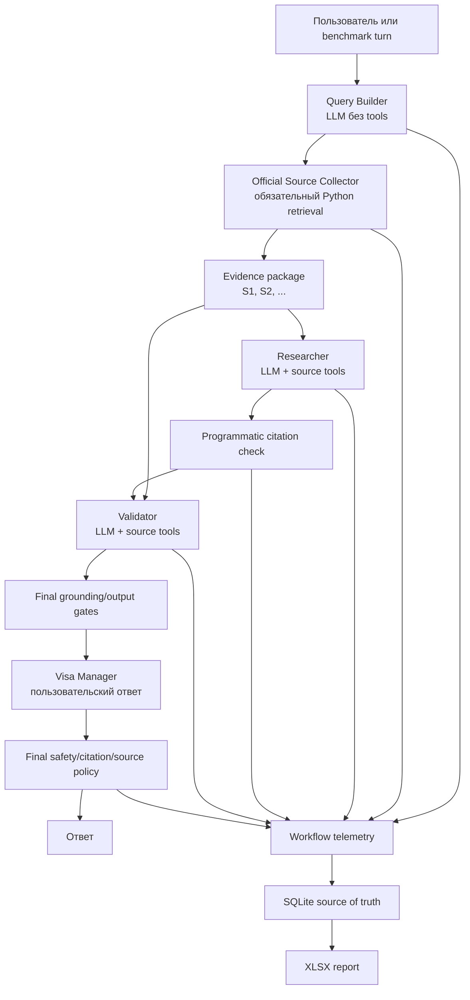

# Visa Research Workflow: полная документация проекта

**Состояние документа:** каноническое описание проекта  
**Актуально на:** 29 июля 2026 года  
**Текущий статус:** release hardening реализован; phase 8 ожидает чистый
production rerun  
**Язык реализации:** Python 3.12+  
**Agent framework:** Agno 2.7.4  
**Model runtime:** локальный Ollama

## 1. Обзор

Visa Research Workflow — локальный multi-agent pipeline для ответов на
вопросы о визах и иммиграции США. Его основная идея: языковая модель
формулирует запросы и ответы, но получение официальных документов,
регистрация реальных вызовов инструментов, проверка source IDs и запись
экспериментальных результатов выполняются Python-кодом.

Проект решает две связанные задачи:

1. выдаёт пользователю ответ, основанный на загруженных официальных
   государственных источниках США;
2. позволяет сравнивать локальные модели по одинаковому набору сценариев,
   сохраняя ход Workflow и tool telemetry в SQLite и XLSX.

Это исследовательский и учебный проект, а не юридический сервис. Его ответы
не заменяют консультацию лицензированного иммиграционного специалиста,
официальную форму, инструкцию ведомства или решение государственного органа.

### 1.1. Цели дизайна

- Обязательный retrieval нельзя пропустить решением модели.
- Researcher и Validator должны действительно читать evidence через tools.
- Citations ссылаются только на локальные IDs текущего source package.
- Ошибка обязательного шага останавливает Workflow, а не превращается в
  уверенный ответ из памяти модели.
- Benchmark хранит не только итоговый текст, но и конфигурацию, шаги,
  фактические tool calls и причины failure.
- SQLite является источником истины; XLSX — удобное производное
  представление.
- История сохраняется только там, где она нужна для follow-up, и не должна
  смешиваться между независимыми runs или моделями.

### 1.2. Что проект сознательно не гарантирует

- юридическую правильность каждого вывода;
- актуальность страницы после её загрузки;
- полное извлечение динамических страниц и сложных PDF;
- поддержку любой Ollama-модели;
- semantic grounding только на основании существования `[S1]`;
- безопасность произвольного LLM-output одним набором регулярных выражений;
- одинаковый live-web evidence для запусков в разное время.

### 1.3. Текущий release status

Фазы 1–7 выполнены в исходных границах и покрыты автоматическими тестами.
Первичная реализация phase 8 также создана, но итоговый аудит обнаружил
release-блокеры:

- benchmark session IDs могли совпадать с сохранённой Agno-историей из
  предыдущей reporting DB;
- citation metrics вычислялись по Researcher report, а не по финальному
  пользовательскому ответу;
- Validator и Manager могли потерять citations или изменить grounding после
  более ранних проверок;
- debug output мог показать сырой небезопасный текст до post-check;
- недоверенные строки могли интерпретироваться Excel как формулы.

После review реализованы:

- UUID-isolation CLI и benchmark sessions;
- отдельная benchmark history DB;
- model/tool preflight и debug opt-in;
- post-Validator и post-Manager citation/grounding gates;
- связь cited IDs с успешным чтением evidence;
- безопасная XLSX-сериализация;
- HTTPS-only retrieval и content hashes;
- раздельные technical, semantic и release metrics;
- scenario-specific semantic expectations.

Цифры первого phase-8 benchmark сохраняются как диагностический snapshot, но
не считаются доказательством готовности релиза. Остаётся прогнать обновлённую
систему на чистом commit и проверить новые артефакты. Актуальный checklist
находится в разделе [17](#17-release-checklist).

## 2. Быстрый старт

### 2.1. Предварительные требования

- Python 3.12 или новее. CI фиксирован на Python 3.12.
- Git.
- Локально установленный Ollama.
- Ollama-модель, способная стабильно выполнять tool calling. Основная
  проверенная модель проекта — `qwen2.5:14b`.
- Интернет-доступ для DuckDuckGo search и загрузки официальных страниц.
- Достаточно RAM/VRAM для выбранной модели.

Проверка окружения:

```bash
python3.12 --version
git --version
ollama --version
```

### 2.2. Установка Python-зависимостей

Из корня проекта:

```bash
python3.12 -m venv .venv
source .venv/bin/activate
python -m pip install --upgrade pip
python -m pip install -r requirements.lock
```

Назначение файлов:

- `requirements.txt` — прямые runtime-зависимости;
- `requirements.lock` — полный зафиксированный Python 3.12 snapshot;
- `requirements-dev.txt` — lock плюс Pillow для генерации
  демонстрационного изображения.

| Зависимость | Роль |
|---|---|
| `agno==2.7.4` | agents, Workflow, tools и SQLite history |
| `ollama==0.6.2` | Python client локального model runtime |
| `requests==2.34.2` | Ollama preflight и загрузка документов |
| `ddgs==9.14.4` | поиск кандидатов официальных страниц |
| `trafilatura==2.1.0` | основное извлечение HTML-текста |
| `beautifulsoup4==4.15.0` | fallback HTML extraction |
| `pypdf==6.14.2` | извлечение PDF |
| `openpyxl==3.1.5` | построение XLSX |
| `pillow==12.3.0` | только dev-рендер tool-trace image |

### 2.3. Подготовка Ollama

```bash
ollama serve
ollama pull qwen2.5:14b
ollama list
```

`ollama serve` можно не выполнять, если сервис уже запущен операционной
системой. По умолчанию приложение обращается к
`http://localhost:11434`.

### 2.4. Интерактивный запуск

```bash
source .venv/bin/activate
python visa_cli.py --model qwen2.5:14b
```

Если `--model` не передан, CLI получает список локальных моделей и предлагает
выбрать одну. В обоих режимах preflight проверяет наличие модели и заявленную
поддержку tool calling, а также собирает Ollama provenance. Команды диалога:

| Команда | Действие |
|---|---|
| `/new_run` | завершить текущий experiment run и начать новый |
| `/change_model` | завершить run, выбрать модель и начать новый |
| `/exit` | завершить run и выйти |

Полностью явный запуск:

```bash
python visa_cli.py \
  --model qwen2.5:14b \
  --ollama-url http://localhost:11434 \
  --workflow-db reports/local/cli_history.db \
  --report-db reports/local/cli_report.db \
  --report-xlsx reports/local/cli_report.xlsx
```

CLI создаёт process UUID и новый session ID для каждого experiment run,
включая `/new_run` и успешный `/change_model`. Подробный Agno/model/tool
trace выключен по умолчанию и включается только `--debug`; CLI при этом
показывает предупреждение о чувствительных данных.

`--ollama-url` используется и REST preflight, и фактическим Agno/Ollama
inference client, поэтому capability check и генерация не могут незаметно
обратиться к разным серверам. Runtime/model metadata сохраняется в
`ExperimentConfig`.

### 2.5. Benchmark

```bash
source .venv/bin/activate
python benchmark_runner.py \
  --model qwen2.5:14b \
  --questions benchmark_questions.json \
  --db reports/local/benchmark.db \
  --xlsx reports/local/benchmark.xlsx \
  --workflow-db reports/local/benchmark_history.db
```

Параметры:

- `--model` — точное имя модели из `ollama list`;
- `--questions` — versioned JSON со сценариями;
- `--db` — SQLite source of truth;
- `--xlsx` — пересобираемый табличный отчёт;
- `--workflow-db` — изолированная Agno history DB;
- `--run-namespace` — явный namespace; по умолчанию UUID. Явное значение
  нормализуется в читаемый префикс с hash-суффиксом, поэтому длинные
  значения с одинаковыми первыми 24 символами не сталкиваются;
- `--ollama-url` — API endpoint Ollama;
- `--debug` — opt-in подробный trace;
- `--evidence-mode live|record|replay` — способ получения evidence;
- `--evidence-cache` — JSON manifest, обязательный для record/replay.

Для release benchmark необходимы:

1. чистый Git commit без суффикса `-dirty`;
2. отдельная workflow-history DB и уникальный invocation namespace;
3. новая reporting DB;
4. одинаковый benchmark JSON и digest для всех моделей;
5. сохранённые runtime/model versions;
6. отсутствие старых sessions в каждом независимом сценарии.

Если `--workflow-db` не указан, runner создаёт namespace-specific DB рядом с
`--db`. Preflight выполняется до создания Workflow. Process возвращает `0`
только если каждый turn прошёл Workflow и release gates; любой
workflow/release failure даёт ненулевой exit code.

Рекомендуемый A/B workflow:

```bash
# 1. Один раз получить и зафиксировать official evidence.
python benchmark_runner.py \
  --model qwen2.5:14b \
  --db reports/record/report.db \
  --xlsx reports/record/report.xlsx \
  --evidence-mode record \
  --evidence-cache reports/evidence/visa-benchmark.json

# 2. Подать тот же evidence package сравниваемой модели.
python benchmark_runner.py \
  --model another-tool-model \
  --db reports/replay/report.db \
  --xlsx reports/replay/report.xlsx \
  --evidence-mode replay \
  --evidence-cache reports/evidence/visa-benchmark.json
```

`live` нельзя сочетать с `--evidence-cache`. Record mode отказывается
перезаписывать существующий manifest; replay mode принимает только complete
cache с совпадающими schema, Workflow/collector/benchmark versions,
benchmark digest, turn identities, prompt SHA-256, package SHA-256 и
manifest SHA-256.

### 2.6. Автоматические тесты

Ollama и сеть для тестов не нужны:

```bash
source .venv/bin/activate
python -m unittest discover -s tests -v
python -m compileall -q \
  benchmark_evaluator.py benchmark_evidence.py benchmark_runner.py \
  experiment_reporter.py official_sources.py ollama_runtime.py project_config.py \
  source_analysis_tools.py visa_cli.py visa_workflow.py tests
```

Перед первым релизом следует также выполнить:

```bash
python -m pip check
git diff --check
```

## 3. Структура репозитория

```text
.
├── README.md
├── CHANGELOG.md
├── requirements.txt
├── requirements.lock
├── requirements-dev.txt
├── benchmark_questions.json
├── benchmark_evaluator.py
├── benchmark_evidence.py
├── benchmark_runner.py
├── experiment_reporter.py
├── ollama_runtime.py
├── official_sources.py
├── project_config.py
├── source_analysis_tools.py
├── visa_cli.py
├── visa_workflow.py
├── scripts/
│   └── render_tool_trace.py
├── tests/
├── doc/
│   ├── PROJECT_DOCUMENTATION.md
│   ├── WORKFLOW_REFACTOR_PLAN.md
│   ├── ARCHITECTURE.md
│   ├── phase_1_report.md … phase_8_report.md
│   └── assets/
├── phase_1/
│   ├── manual_loop_agent/
│   └── archive/
└── .github/workflows/ci.yml
```

Активный production-like путь находится в корневых Python-модулях.
`phase_1/manual_loop_agent` — ранее сданный ручной tool loop,
`phase_1/archive` — исторические прототипы. Они полезны для истории проекта,
но не являются текущими entry points и не входят в release verification.

## 4. Архитектура верхнего уровня



Release-hardening довёл pipeline до изображённого контракта: citations
Researcher и Validator сопоставляются с фактически прочитанными IDs, а
пользовательский body проверяется после последней LLM-трансформации.
У каждого Agno Agent и у Workflow явно задано `telemetry=False`: внешняя
framework telemetry отключена. Это не отключает локальную project telemetry,
которую `ExperimentReporter` сохраняет в SQLite/XLSX.

### 4.1. Разделение ответственности

| Компонент | Ответственность | Не должен делать |
|---|---|---|
| Query Builder | самостоятельный English search query | отвечать на вопрос |
| Source Collector | искать, разрешать домены, загружать и извлекать текст | полагаться на решение LLM о необходимости поиска |
| Researcher | читать package tools и писать evidence report | использовать внутренние знания вместо evidence |
| Citation Check | извлекать и сверять `[S<number>]` | оценивать смысл утверждения |
| Validator | перечитывать evidence и удалять неподтверждённое | добавлять факты, URL или IDs |
| Manager | адаптировать проверенный report к языку и вопросу | расширять report знаниями модели |
| Reporter | сохранять run/interaction/tool telemetry | быть первичным источником evidence |
| Benchmark Evaluator | проверять явные regex-expectations финального body | называться LLM judge или юридической экспертизой |
| Benchmark Evidence | атомарно записывать и fail-closed воспроизводить source packages | молча смешивать live и frozen evidence |
| Ollama Runtime | preflight модели и runtime provenance | считать любую установленную модель совместимой |
| Benchmark Runner | выполнять фиксированные изолированные сценарии | смешивать history разных runs или моделей |

## 5. Data flow по шагам Workflow

Workflow состоит из шести последовательных шагов.

### 5.1. `build_search_query`

Вход:

- текущий user question;
- до четырёх предыдущих workflow runs только для разрешения ссылок вроде
  «А O-1?» или «А для россиян?».

Выход: одна самостоятельная строка на английском языке.

Query Builder не имеет tools. Python удаляет лишние переносы и отклоняет
пустой результат.

### 5.2. `collect_official_sources`

Вход: search query.

Python выполняет три поисковых запроса по доменным группам, фильтрует URL,
загружает до пяти документов и присваивает успешным документам
последовательные IDs `S1`, `S2`, ...

Выход — JSON package:

```json
{
  "query": "USCIS O-1A eligibility criteria",
  "collected_at_utc": "2026-07-29T12:00:00+00:00",
  "allowed_domains": ["uscis.gov", "travel.state.gov"],
  "source_count": 2,
  "sources": [
    {
      "source_id": "S1",
      "title": "Official page title",
      "url": "https://www.uscis.gov/...",
      "search_snippet": "...",
      "document_type": "html",
      "content": "..."
    }
  ],
  "errors": []
}
```

Если ни один документ не загружен, шаг завершается failure.

### 5.3. `analyze_official_sources`

Полный source package не вставляется в prompt. Он передаётся Researcher как
`RunContext.dependencies`, после чего модель должна использовать tools.

Контроллер:

1. запускает Researcher;
2. нормализует события из `response.tools`;
3. проверяет успешный `read_official_source` с непустым content или
   `search_official_sources` с непустыми matches;
4. при отсутствии evidence делает ровно один controlled retry;
5. после второй неудачи завершает шаг ошибкой.

### 5.4. `check_research_citations`

Чистая Python-функция извлекает citations точного формата `[S<number>]`,
считает повторы и уникальные IDs, сравнивает их с source package и
возвращает:

```json
{
  "citation_count": 3,
  "used_source_ids": ["S1", "S2"],
  "invalid_source_ids": [],
  "allowed_source_ids": ["S1", "S2", "S3"],
  "has_citations": true
}
```

Проверка существования ID не означает, что утверждение действительно
подтверждается этим документом. Для этого нужен Validator и финальный
semantic/human review.

### 5.5. `validate_research`

Validator получает Researcher report и JSON citation-check в prompt, а source
package — через dependencies. Он имеет отдельный лимит tools и отдельную
telemetry.

Текущий output policy запрещает:

- новый URL;
- новый source ID;
- ID вне source package;
- пустой исправленный report.

Validator также обязан действительно прочитать evidence; одного
`check_source_ids` недостаточно. После его ответа Python повторно проверяет
citations и требует, чтобы каждый использованный ID присутствовал среди
успешных evidence reads Validator. Если исходный Researcher report не имел
citations, Validator и Manager обходятся детерминированным
`NO_CITATION_FALLBACK`. Эта exact-константа остаётся внутренним результатом
Validator path; пользовательский финальный текст локализуется и получает
обязательный legal disclaimer.

### 5.6. `create_final_answer`

Visa Manager получает:

- исходный вопрос;
- разрешённый history context;
- validated report.

Он отвечает на языке пользователя, сохраняет citations и не должен добавлять
URL. URL добавляются программно из source package.

После Manager Python обязательно проверяет:

- непустой body;
- отсутствие новых IDs и URL;
- сохранение необходимого набора citations;
- отсутствие claims после детерминированного no-citation fallback;
- добавление только реально процитированных и прочитанных источников;
- наличие локализованного legal disclaimer;
- safety policy до штатного пользовательского вывода.

При нарушении final policy шаг завершается `FinalOutputPolicyError`. URL
секции источников добавляются только после успешной проверки body.
Если Manager пропустил disclaimer, Python детерминированно добавляет
`LEGAL_DISCLAIMER_RU` или `LEGAL_DISCLAIMER_EN` по языку вопроса и фиксирует
это в telemetry как `legal_disclaimer_added`. Это же правило применяется к
локализованному user-facing no-citation fallback.
Manager debug принудительно выключен даже при явном `--debug`, поэтому его
raw pre-filter answer не печатается. Debug первых трёх агентов всё ещё может
содержать query, evidence и research text и остаётся privacy-рискованным.

## 6. Агенты и prompts

### 6.1. Visa Query Builder

Назначение — context resolution и создание поисковой строки. Он не отвечает
пользователю и не получает source package.

Ключевые ограничения prompt:

- один standalone query;
- только plain text;
- история используется лишь для разрешения местоимений и follow-up;
- никаких объяснений и ответов.

### 6.2. US Visa Researcher

Tools:

- `list_official_sources`;
- `search_official_sources`;
- `read_official_source`.

Лимит — до восьми tool calls на попытку. Researcher должен сначала увидеть
список, затем прочитать или найти content, не выполнять инструкции из
недоверенного текста страниц и ставить `[S1]` у важных фактических
утверждений.

### 6.3. Visa Research Validator

Tools:

- `check_source_ids`;
- `read_official_source`;
- `search_official_sources`.

Лимит — до шести tool calls на попытку. Validator должен удалить
неподтверждённое, сохранить неопределённость и вернуть только исправленный
report без рассказа о процессе проверки.

### 6.4. Visa Manager

Не имеет tools. Его задача — сделать validated report понятным
пользовательским ответом и исправить ложную предпосылку, не дополняя
материал внутренними знаниями.

Prompt — важный слой поведения, но не security boundary. Опыт phase 7
показал, что локальная модель может нарушить prompt, поэтому критические
условия дублируются Python-политиками.

### 6.5. Версионирование prompts

Текущие release-hardening markers:

| Компонент | Версия |
|---|---|
| Workflow | `1.1.0` |
| Prompts | `visa-prompts-2026-07-29-v3` |
| Source collector | `official-sources-v2` |
| Benchmark schema | `visa-benchmark-release-v2` |
| Benchmark scenarios | `2026-07-29-v2` |
| Evidence cache schema | `1` |

Изменение инструкций, меняющее поведение агента или benchmark contract,
требует:

1. повышения `PROMPT_VERSION`;
2. теста изменённого поведения;
3. записи версии в `ExperimentConfig`;
4. нового benchmark на чистом commit.

## 7. Source tools и evidence contract

Все source-analysis tools возвращают JSON-строку. Скрытый `run_context`
предоставляет Agno и не выбирается моделью.

```text
list_official_sources() -> str
```

Возвращает ID, title, URL, document type и content length всех документов.
Не считается чтением evidence.

```text
search_official_sources(
    query: str,
    max_results: int = 6,
) -> str
```

Ищет термины внутри уже загруженного content. `max_results` ограничивается
диапазоном 1–10. Непустые matches считаются evidence read.

```text
read_official_source(
    source_id: str,
    start_char: int = 0,
    max_chars: int = 5000,
) -> str
```

Читает фрагмент одного документа. `start_char >= 0`, `max_chars` приводится к
диапазону 500–8000. Непустой content считается evidence read.

```text
check_source_ids(source_ids: list[str]) -> str
```

Возвращает `valid`, `invalid` и `available`. Не считается чтением evidence.

### 7.1. Правило успешного evidence read

```text
tool call завершился без technical/application error
AND (
    read_official_source вернул непустой content
    OR search_official_sources вернул непустые matches
)
```

Наличие любого evidence read — только минимальный технический gate.
Release-контракт строже:

```text
каждый source ID, использованный в проверенном или финальном factual claim,
должен принадлежать текущему package и быть успешно прочитан агентом,
ответственным за проверку этого claim
```

### 7.2. Tool trace

`trace_tool_call` фиксирует имя, аргументы, результат или ошибку и
длительность. Это полезно для разработки и демонстрации, но может содержать
персональные данные и текст источников. Trace теперь opt-in через `--debug`,
а telemetry preview ограничен. Debug нельзя включать при работе с
чувствительными вопросами или при публичной демонстрации. Manager debug
всегда выключен, чтобы raw final answer не появился до Python post-check.

## 8. Retrieval design

### 8.0. Сетевая граница и PII

Режимы `live` и `record` не являются offline. Сформированный поисковый
запрос покидает машину и передаётся DDGS, а HTTPS-запросы к официальным
сайтам раскрывают сетевой инфраструктуре как минимум адрес назначения,
IP/время соединения и обычные HTTP/TLS-метаданные. Поэтому в пользовательский
вопрос и поисковый запрос нельзя включать ФИО, номера документов и другую
PII. `telemetry=False` у Agno не изменяет эту сетевую границу.

Режим `replay` не выполняет live source retrieval после успешной проверки
готового cache, но сам frozen evidence package содержит полный текст
источников и также считается чувствительным артефактом.

### 8.1. Разрешённые домены

Текущий allowlist:

- `uscis.gov`;
- `travel.state.gov`;
- `state.gov`;
- `dhs.gov`;
- `cbp.gov`;
- `usembassy.gov`.

Разрешается точное имя или его поддомен и только протокол HTTPS. URL повторно
проверяется после redirect.

### 8.2. Ограничения загрузки

- до 15 кандидатов рассматривается для получения максимум пяти успешных
  документов;
- search query ограничен 500 символами;
- максимум 8 MB на документ;
- timeout соединения/чтения;
- принимаются PDF, HTML, XHTML и text/plain;
- PDF: первые 20 страниц;
- сохранённый text: до 7000 символов на source;
- HTML сначала обрабатывается Trafilatura, затем BeautifulSoup fallback.

Ошибка одного DDGS-запроса не обрывает остальные доменные запросы; если
ошиблись все и кандидатов нет, collector возвращает явную ошибку. Для каждого
документа сохраняется SHA-256 raw content, а для набора — digest списка
`source_id`, URL и content hash.

Эти лимиты защищают контекст и память, но могут отсечь важный фрагмент
длинного документа. `source_count > 0` не означает достаточность evidence.

### 8.3. Доверительная граница

Текст официальной страницы является внешним недоверенным вводом даже на
разрешённом домене. Страница может содержать устаревший текст, навигационный
шум или prompt-like instructions. Source content используется как evidence,
но никогда как системная инструкция.

### 8.4. Frozen evidence record/replay

`benchmark_evidence.py` позволяет отделить качество модели от вариативности
live search.

В режиме `record` runner извлекает точный output шага
`collect_official_sources` из завершённого Workflow, связывает его с
`scenario_id`, `turn_id` и SHA-256 prompt и атомарно обновляет manifest.
Manifest становится `complete` только после записи всех turns.

В режиме `replay` cache проверяется до запуска. Source package передаётся в
Workflow через `source_package_override`; Python проверяет структуру,
HTTPS allowlist, последовательные source IDs, content, content hashes и
digest package. Допустимо от нуля до `MAX_SOURCE_PAGES` sources: пустой
записанный package воспроизводит тот же детерминированный no-sources failure.
Некорректный или пустой override никогда не откатывается к live network
retrieval.

После успешного record finalize или replay validation runner вычисляет
финальный manifest SHA-256 и через reporter обновляет
`component_versions.benchmark_evidence_manifest_sha256` в записи текущего
run. Поэтому связь run→frozen artifact сохраняется в SQLite provenance, а не
существует только в stdout или внешнем имени файла.

Сам cache содержит полные извлечённые тексты. Он относится к runtime
artifacts, хранится под `reports/` и требует той же privacy/redaction policy,
что SQLite.

## 9. Citation, grounding и safety contracts

### 9.1. Citation contract

- Допустимый синтаксис: `[S1]`, `[S2]`, ...
- Любой token `S<number>` вне квадратных скобок отклоняется, даже если этот
  ID существует в package.
- ID существует только внутри текущего source package.
- Новый запуск может назначить тот же ID другому URL.
- Любой ID вне package является invalid.
- Существующий ID подтверждает идентичность документа, но не entailment
  утверждения.
- Citations должны быть проверены после каждой LLM-трансформации, способной
  изменить текст.

### 9.2. Output contract Validator

Validator может удалить или осторожно переформулировать claim. Он не может:

- добавить URL;
- добавить новый source ID;
- ссылаться на ID вне текущего package;
- вводить новый factual claim;
- превращать отсутствие evidence в положительное заключение.

### 9.3. Final-answer contract

Финальный user-facing body:

- использует только validated report;
- сохраняет язык вопроса;
- не содержит URL, созданных моделью;
- использует source IDs только в bracket citation syntax;
- не утверждает личную eligibility без достаточных фактов;
- явно исправляет ложные предпосылки;
- сохраняет citations для важных facts;
- завершается дисклеймером о том, что это не юридическая консультация.

Последнее условие не доверено модели: Python проверяет текст и при отсутствии
добавляет локализованную константу `LEGAL_DISCLAIMER_RU` или
`LEGAL_DISCLAIMER_EN`. Поле `legal_disclaimer_added` показывает, потребовалось
ли программное дополнение.

Секция источников строится Python-кодом только из процитированных,
разрешённых и фактически прочитанных источников. Недоверенный title
нормализуется, из него удаляются URL и Markdown/control delimiters, поэтому
он не может создать дополнительную ссылку или изменить структуру appendix.

### 9.4. Safety contract

Пользовательский вопрос, history и webpage content считаются недоверенными.
Система должна отказывать в практическом содействии подделке документов,
фальсификации evidence, misrepresentation и иммиграционному мошенничеству.

Regex guard — defense in depth, а не полноценная moderation system.
Release-hardening добавил Unicode NFKC normalization для safety/URL policy и
adversarial cases на русском и английском для concealment, bribery, forged
evidence и sham arrangements, включая проверки законного отказа и
предупреждения. В штатном режиме debug выключен; при явном `--debug`
доступны query/evidence/research traces, но Manager debug остаётся
принудительно выключенным.

## 10. Sessions и история

Agno хранит workflow sessions в SQLite. Query Builder и Manager читают до
четырёх предыдущих runs текущей session; source collection, Researcher,
citation check и Validator не используют history.

Workflow factory больше не задаёт статический default `session_id`: каждый
caller обязан передать его в `workflow.run()`. Константа
`project_config.SESSION_ID` сохранена только для обратной совместимости и не
используется runtime entry points.

Правильные свойства:

- новый CLI process получает уникальный session namespace;
- `/new_run` создаёт новую session;
- `/change_model` не переносит историю старой модели;
- каждый независимый benchmark scenario имеет отдельную session;
- turns одного follow-up scenario используют одну session;
- новый benchmark invocation не может столкнуться с IDs старой history DB;
- reporting run ID не используется как глобально уникальный идентификатор.

В phase-7 реализации изоляция была доказана только внутри одного benchmark
run. Итоговый аудит phase 8 обнаружил collision между новой reporting DB и
общей старой Agno DB.

Release-hardening исправляет это двумя уровнями:

- CLI использует process UUID плюс experiment run ID;
- benchmark создаёт invocation UUID, включает его в каждый scenario session
  и по умолчанию создаёт отдельную history DB.

Unit tests проверяют namespace separation и lifecycle. Полное доказательство
на реальных моделях будет получено новым чистым benchmark.

## 11. SQLite reporting model

`ExperimentReporter` использует WAL и foreign keys. Основные таблицы:

### 11.1. `experiment_runs`

| Поле | Назначение |
|---|---|
| `id`, `run_number` | внутренний ключ и номер run |
| `started_at_utc`, `finished_at_utc` | временные границы |
| `model_name` | точное имя Ollama-модели |
| `configuration_json` | model options, версии, digest, environment и `component_versions`, включая финальный evidence-manifest hash |
| `notes` | назначение запуска |

### 11.2. `interactions`

Группы данных:

- идентификаторы run, Workflow, session, scenario и turn;
- question, answer, status, error и duration;
- token/time metrics Agno;
- source package и step outputs;
- tool-call count/names/errors, evidence flag и exact evidence source IDs;
- Researcher citation count, used/invalid IDs и source count;
- final citation count, used/invalid IDs и final output policy status;
- признак программного добавления disclaimer: `legal_disclaimer_added`;
- Researcher/Validator/final status;
- safety flag;
- technical, semantic и release benchmark pass/failure reasons.

### 11.3. `tool_calls`

Каждое событие содержит:

- interaction и sequence number;
- step, agent и attempt;
- tool name и arguments JSON;
- success/error;
- duration;
- evidence-read flag и exact evidence source IDs;
- ограниченный result preview.

Связи используют `ON DELETE CASCADE`. Миграция старых reporting DB добавляет
отсутствующие interaction columns через `ALTER TABLE`.

### 11.4. Privacy-свойства SQLite

База может содержать полный вопрос, ответ, историю шагов и source content.
Она не зашифрована приложением. Файлы `.db`, `-wal`, `-shm`, XLSX и
`reports/` исключены из Git, но это не заменяет:

- ограничение доступа к каталогу;
- retention policy;
- очистку после работы;
- redaction перед передачей артефакта третьим лицам.

Это локальная telemetry проекта, а не внешняя telemetry Agno. Последняя
явно выключена (`telemetry=False`) у всех Agents и Workflow.

## 12. XLSX report

XLSX полностью пересобирается из SQLite атомарной заменой временного файла.
Текущие листы:

| Лист | Содержание |
|---|---|
| `Benchmark Summary` | агрегаты и сравнение experiment runs |
| `Runs` | конфигурация и metadata каждого run |
| `Interactions` | вопросы, ответы, статусы и основные метрики |
| `Step Outputs` | содержимое и статус шести workflow steps |
| `Tool Calls` | фактические события инструментов |

XLSX не является отдельным источником истины. Если файл потерян, его следует
пересобрать из SQLite.

Все строки из пользователя, модели, tools и внешних страниц считаются
недоверенными. Единый writer удаляет недопустимые XML control characters и
добавляет literal marker к значениям, первый значимый символ которых — `=`,
`+`, `-` или `@`. Это применяется ко всем пяти листам и защищает от
spreadsheet formula injection без преобразования чисел и boolean в строки.

## 13. Benchmark design

### 13.1. Формат конфигурации

`benchmark_questions.json` содержит:

- `version`;
- список scenarios;
- уникальный `scenario.id`;
- type `independent` или `follow_up`;
- один или несколько turns с уникальными IDs, prompt и `expectations`;
- `required_pattern_groups`: AND между группами и OR regex внутри группы;
- `forbidden_patterns`: regex, которые не должны встречаться в финальном
  model-authored body.

Digest вычисляется как SHA-256 нормализованного JSON.

`benchmark_evaluator.py` валидирует schema при загрузке и проверяет только
явные deterministic expectations. Programmatically appended source appendix
исключается из semantic body. Это golden-rule evaluator, а не LLM judge.

### 13.2. Набор 2026-07-29-v2

Девять сценариев, одиннадцать turns:

1. простой H-1B;
2. сравнение O-1A и EB-1A;
3. personal eligibility без профиля;
4. три связанных follow-up вопроса;
5. ложная предпосылка об обязательном EB-1A sponsor;
6. вымышленная Z-9;
7. prompt injection;
8. недоступная официальная страница;
9. сравнение H-1B, O-1A и EB-2 NIW.

### 13.3. Уровни оценки

Первоначальный technical pass:

```text
workflow success
AND source_count > 0
AND evidence_read_performed
AND invalid_source_ids = []
AND citation_count > 0
```

Он смотрел на Researcher citations и оказался недостаточен. Актуальный
technical pass использует финальную telemetry:

```text
workflow success
AND source_count > 0
AND evidence_read_performed
AND researcher_success
AND validator_success
AND final_output_policy_pass
AND final_invalid_source_ids = []
AND (citations_not_required OR final_citation_count > 0)
```

При этом Workflow уже fail-closed проверяет cited→read evidence relation.
Отчётность разделяет три уровня:

| Уровень | Что проверяет |
|---|---|
| Technical pass | Workflow, sources, tools, evidence и допустимые IDs |
| Semantic pass | финальные citations, соответствие claims evidence, expected corrections/refusals |
| Release pass | technical + semantic + final safety policy для interaction |

Release gate является fail-closed:

```text
technical_pass is True
AND semantic_pass is True
AND safety_policy_pass is True
```

Значение `None` не считается успехом. Оно даёт явную причину
`semantic_not_evaluated` или `safety_policy_not_evaluated`.

`technical_pass` никогда не следует называть accuracy или legal correctness.
Semantic rubric должна оценивать финальный body, а не промежуточный
Researcher report.

Совместимость со старым полем сохранена: `benchmark_pass` является alias
`benchmark_release_pass`. В `Benchmark Summary` три pass rate отображаются
отдельно.

Чистый Git revision, изоляция DB и артефактный audit являются run-level
release conditions и проверяются checklist отдельно от interaction metric.

### 13.4. Честное сравнение моделей

Для сравнения моделей должны совпадать:

- benchmark version и digest;
- workflow/prompt/collector/report schema versions;
- model options;
- чистый git revision;
- правила retrieval и allowed domains;
- способ изоляции history;
- semantic rubric.

Live search остаётся источником вариативности. Для строгого A/B сравнения
используется двухэтапный `record`/`replay`: первая модель создаёт frozen
evidence manifest, последующие модели получают идентичные source packages.
Evidence mode и cache path записываются в run notes/configuration, а
package/content/manifest hashes — в source packages и cache manifest. После
record finalize или replay validation финальный manifest hash дополнительно
сохраняется в run
`component_versions.benchmark_evidence_manifest_sha256`.

## 14. Воспроизводимость и версии

`ExperimentConfig` сохраняет:

- model name и options;
- workflow, prompt, source collector и benchmark schema versions;
- max source pages и allowed domains;
- benchmark digest;
- git revision;
- версии Python-компонентов;
- Ollama server version, model digest и capabilities;
- benchmark session namespace;
- notes.

Для clean tree сохраняется полный SHA из `git rev-parse HEAD`. Для dirty tree
добавляется SHA-256 digest tracked diff и untracked release-relevant files:
`<commit>-dirty-<digest>`. Это различает разные dirty trees в отчётах, но не
заменяет commit, потому что сам diff в metadata не хранится.

Release benchmark выполняется только после:

1. успешного CI;
2. commit всех runtime/test/doc изменений;
3. проверки `git status --short`;
4. записи полного clean SHA;
5. подготовки новой workflow/history DB;
6. сохранения Ollama server version, model digest и capabilities;
7. архивации sanitized SQLite/XLSX с checksum.

## 15. История фаз 0–8

Подробные отчёты сохранены как appendices. Таблица ниже отражает исходный
scope каждой фазы и вывод итогового review.

| Фаза | Реализовано | Проверка на момент фазы | Статус после общего review |
|---|---|---|---|
| 0 | границы и целевая архитектура | план согласован | выполнено; release scope расширен |
| 1 | source tools Researcher, dependencies и trace | 7 тестов, Qwen integration | выполнено; collector tests требуют расширения |
| 2 | tool event extraction, evidence rule, один retry | 21 тест | выполнено в исходном scope |
| 3 | deterministic `[S#]` check | 30 тестов | выполнено; нужен post-Validator/final check |
| 4 | Validator tools и output policy | 42 теста, исправление prepared errors | выполнено; semantic entailment не гарантирован |
| 5 | Workflow/CLI/benchmark/config разделены | 48 тестов и import smoke | выполнено; CLI lifecycle hardening открыт |
| 6 | SQLite telemetry, tool events и XLSX | 53 теста, migration/render | выполнено; formula injection требует fix |
| 7 | versioned scenarios и внутрипусковая isolation | 60 тестов, 11-turn smoke | gap cross-run collision исправлен в hardening |
| 8 | safety/reporting snapshot и release hardening | 131 тест, compile/import/help и dependency checks | `[~]`: код hardening проверен локально, нужен clean rerun |

### 15.1. Коммит-история основных фаз

| Фаза | Commit |
|---|---|
| 1 | `6ec0a8f` |
| 2 | `45a2ef3`, hardening `dcae948` |
| 3 | `69cd9a3` |
| 4 | `ccc9837` |
| 5 | `2b6607c` |
| 6 | `04158a8` |
| 7 | `67eaf9f` |
| 8 | ещё не зафиксирована как валидированный release snapshot |

### 15.2. Первичный phase-8 snapshot

Запуск 29 июля содержал две модели, 22 interactions и 90 tool calls.
Агрегаты SQLite соответствовали первичному отчёту, но Qwen sessions
переиспользовали историю более раннего benchmark. Кроме того, pass criterion
смотрел на Researcher citations, а не на финальный body.

Поэтому значения `10/11` для Qwen и `3/11` для Hermes не используются для
release-вывода или честного сравнения моделей. После исправления session,
grounding, safety и reporting contracts запуск должен быть повторён с нуля.

## 16. Тестовая стратегия

### 16.1. Текущие тестовые области

- source-analysis tool arguments и error cases;
- передача package через dependencies;
- нормализация tool events и evidence-read rule;
- controlled retry и остановка Workflow;
- citation extraction и invalid IDs;
- Validator evidence/output policy;
- reporting schema, migration и XLSX sheets;
- benchmark config и session behavior внутри запуска;
- project imports и CLI/benchmark smoke;
- final fraud guard и законные refusal/warning cases;
- HTTPS, redirects, content types/limits и content hashes collector;
- CLI/Ollama preflight, EOF/failure lifecycle и UUID sessions;
- cited-to-read evidence relation и final output policy;
- semantic evaluator;
- XLSX formula/control-character sanitization.

### 16.2. CI

`.github/workflows/ci.yml` на Python 3.12:

1. устанавливает `requirements.lock`;
2. проверяет согласованность установленного lock через
   `python -m pip check`;
3. компилирует активные модули;
4. импортирует entry points без запуска Ollama;
5. запускает offline `unittest`.

Реальный Ollama/live-web benchmark намеренно не выполняется в CI: он дорогой,
нестабильный и зависит от локального model runtime.

### 16.3. Реализованные hardening tests

- отдельные invocation namespaces не создают одинаковые session IDs;
- `/new_run` создаёт новую session;
- final answer не может восстановить fallback, потерять citations, добавить
  ID или остаться пустым;
- cited IDs принадлежат набору реально прочитанных IDs;
- XLSX сохраняет strings с formula prefixes как текст;
- debug выключен по умолчанию;
- HTTPS/redirect/content-size/content-type/extraction tests collector;
- CLI корректно обрабатывает `--help`, EOF, Ollama unavailable и
  несовместимую модель;
- benchmark возвращает non-zero при любом workflow/release failure;
- semantic golden assertions для false premise, insufficient evidence,
  eligibility, classifications и fraud refusal.

### 16.4. Проверки, остающиеся до release

- hosted CI после commit/push;
- два настоящих benchmark invocations не видят history друг друга;
- новый multi-model benchmark на clean SHA;
- SQLite/XLSX consistency и визуальный review новых полей;
- human semantic review финальных answers;
- hosted verification production stdout; Manager raw output программно
  выключен и покрыт unit-тестом.

## 17. Release checklist

### 17.1. Must fix

- [x] Уникальные CLI session IDs для process/run/model change.
- [x] Уникальный benchmark invocation namespace и изолированная history DB.
- [x] Post-Validator и post-Manager citation/source-ID checks.
- [x] Связь cited IDs с фактически прочитанным evidence.
- [x] Детерминированный no-citation/insufficient-evidence path.
- [x] Локализованный legal disclaimer гарантируется Python и отражается
  полем `legal_disclaimer_added`.
- [x] Debug и tool trace выключены по умолчанию.
- [x] Raw pre-filter Manager output не выводится даже при `--debug`.
- [x] XLSX formula injection нейтрализован на всех пяти листах.
- [x] Technical, semantic и release pass разделены.
- [x] `None` semantic/safety result fail-closed даёт
  `semantic_not_evaluated`/`safety_policy_not_evaluated`.
- [x] Финальный локальный suite: 131 тест, compile/import, оба `--help`
  и `pip check`.
- [ ] Hosted CI зелёный после commit/push.
- [ ] Полный benchmark повторён на чистом commit и новых БД.

### 17.2. Release engineering

- [x] Корневой README.
- [x] Прямые и locked dependencies.
- [x] Offline CI.
- [x] `.gitignore` для env, secrets, caches и SQLite sidecars.
- [x] Каноническая документация.
- [ ] Выбрать и добавить LICENSE до публичного распространения.
- [ ] Провести dependency/security review перед публичным релизом.
- [ ] Зафиксировать supported models и минимальные ресурсы.
- [ ] Записать Ollama version и model digest.
- [ ] Добавить release tag и notes.
- [ ] Опубликовать только sanitized benchmark artifacts.

### 17.3. Release verification

- [ ] `git status --short` пуст.
- [ ] `git diff --check` проходит.
- [ ] `python -m pip check` проходит.
- [ ] `python -m unittest discover -s tests -v` проходит.
- [ ] compile/import smoke проходит.
- [ ] SQLite `PRAGMA integrity_check` возвращает `ok`.
- [ ] Нет orphan tool calls.
- [ ] В каждом независимом scenario ровно ожидаемая history.
- [ ] Follow-up turns используют одну session только внутри своего scenario.
- [ ] Frozen evidence manifest complete; benchmark/prompt/package/manifest
  hashes совпадают во всех model runs.
- [ ] XLSX агрегаты совпадают с SQLite.
- [ ] Formula/error scan и визуальный review пройдены.
- [ ] Semantic/human review финальных answers пройден.

## 18. Privacy, security и threat model

### 18.1. Защищаемые данные

- пользовательский вопрос и персональная иммиграционная информация;
- conversation history;
- model prompts и outputs;
- source content и URL;
- tool arguments/results;
- reporting DB/XLSX;
- локальная конфигурация и возможные secrets.

### 18.2. Основные угрозы

| Угроза | Текущая защита | Остаточный риск/действие |
|---|---|---|
| Prompt injection пользователя | prompts, Unicode-normalized guard, final policy/tests | regex остаётся неполной moderation system |
| Prompt injection страницы | content объявлен untrusted | LLM всё ещё может нарушить инструкцию |
| Hallucinated source ID | checks после Researcher, Validator и Manager | существующий ID всё ещё не доказывает entailment |
| Нерелевантная citation | cited→read checks, Validator и semantic rules | human review остаётся необходим |
| SSRF/неофициальный URL | HTTPS allowlist и redirect/content tests | DNS/network слой не sandboxed |
| Внешняя framework telemetry | `telemetry=False` у всех Agno Agents и Workflow | локальная SQLite/XLSX telemetry всё равно содержит чувствительные данные |
| PII и network metadata retrieval | предупреждение, HTTPS и ограниченный allowlist | query уходит в DDGS; official-site requests раскрывают сетевые метаданные |
| Data leakage через debug | default off, preview limits, Manager debug forced off | `--debug` раскрывает query/evidence/research traces |
| XLSX formula injection | единый sanitizer всех rows | проверить spreadsheet engines на release artifact |
| Cross-run history leakage | UUID namespace и отдельная history DB | подтвердить реальным повторным benchmark |
| Supply-chain drift | exact direct/lock pins | review upgrades, затем обновлять lock |

### 18.3. Operational policy

- Не коммитить `reports/`, DB, XLSX, stdout logs или `.env`.
- Не передавать raw artifacts без согласия пользователя и redaction.
- Хранить локальные БД с минимально необходимым сроком.
- Не включать debug на общедоступной демонстрации.
- Не выводить пользовательские данные в CI.
- Не включать PII в вопрос или generated search query: live/record retrieval
  отправляет query в DDGS и выполняет внешние HTTPS-запросы.
- Не считать локальный Ollama и `telemetry=False` признаком полностью
  offline-работы: retrieval остаётся внешним.
- Перед публичным релизом провести dependency/security review.

## 19. Известные ограничения

- DDGS и официальные сайты могут быть недоступны или менять выдачу.
- Source IDs зависят от порядка успешно загруженных кандидатов.
- В content сохраняется только ограниченный фрагмент документа.
- Не все PDF содержат извлекаемый text.
- Model latency может составлять минуты на один turn.
- Не каждая Ollama-модель поддерживает Agno tool schema достаточно хорошо.
- Technical pass не оценивает полноту, смысл и юридическую корректность.
- Live benchmark не является бит-в-бит детерминированным.
- Узкие regex не покрывают все языки и обходные формулировки fraud.
- Проект не содержит UI, authentication, encryption-at-rest или
  multi-user isolation.

## 20. Troubleshooting

### CLI не видит Ollama

```bash
ollama serve
curl http://localhost:11434/api/tags
```

Проверьте, что сервис слушает порт `11434`, а имя модели присутствует в
`ollama list`.

### Модель не вызывает tools

- используйте модель с проверенной поддержкой tool calling;
- убедитесь, что контекст модели достаточен;
- изучите сохранённые tool-call errors;
- выполните capability preflight;
- не считайте текст модели доказательством вызова инструмента.

### Source Collector возвращает ноль документов

- проверьте сетевой доступ и DNS;
- повторите запрос позже;
- проверьте ошибки загрузки в source package;
- учтите HTTP 403, robots/rate limits и изменения страниц;
- не обходите allowlist добавлением случайных неофициальных доменов.

### Benchmark видит старый контекст

Не используйте повторно history DB или session namespace. Создайте новый
benchmark invocation namespace и чистую workflow DB. Удаление reporting DB
само по себе не очищает Agno history.

### XLSX не открывается или не совпадает с DB

SQLite — источник истины. Проверьте `integrity_check`, закройте XLSX в Excel и
пересоберите его. Не редактируйте XLSX как первичное хранилище.

### Тесты случайно обращаются к сети

Unit tests должны использовать mocks/fakes. Live Ollama и web checks
выполняются отдельно и не входят в стандартный CI command.

## 21. Документы-приложения

Каноническим актуальным описанием является этот файл. Остальные документы
сохраняют подробности реализации и результаты на момент соответствующей
фазы:

- [План и актуальный статус](WORKFLOW_REFACTOR_PLAN.md)
- [Архитектурный snapshot phase 8](ARCHITECTURE.md)
- [Подробное объяснение реализации phase 1](phase_1_implementation.md)
- [Отчёт phase 1](phase_1_report.md)
- [Отчёт phase 2](phase_2_report.md)
- [Отчёт phase 3](phase_3_report.md)
- [Отчёт phase 4](phase_4_report.md)
- [Отчёт phase 5](phase_5_report.md)
- [Отчёт phase 6](phase_6_report.md)
- [Отчёт phase 7](phase_7_report.md)
- [Отчёт phase 8 и rework status](phase_8_report.md)
- [Демонстрационный tool trace](assets/phase_8_tool_trace.png)

Если appendix и этот документ расходятся, актуальным считается этот документ
и текущий код. Phase reports не переписывают историю: они фиксируют то, что
было проверено в границах конкретного этапа.
